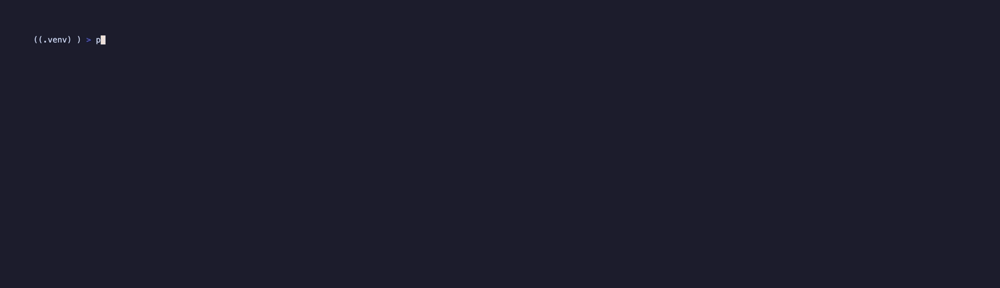

# voicecom-jev

Hold a key, say a command like "open Chrome", "scroll down", "click Submit" or "snap this window left", and your Mac does it.

Speech is transcribed locally with [faster-whisper](https://github.com/SYSTRAN/faster-whisper). Every decision (which command, whether it's destructive, which on-screen button you meant) is made by TypeSafe's **Jev** model, which returns typed answers with probabilities instead of generated text. The actions themselves are plain, deterministic code.

> **Unofficial project.** voicecom-jev is a personal project. It is not affiliated with, endorsed by, or supported by TypeSafe AI.



*Terminal capture of real Jev decisions in `--dry-run --text` mode ([mp4](demo/demo.mp4); regenerate with `vhs demo/demo.tape`). In normal use you hold Right Option and speak instead of typing.*

## How it works

```
hold Right Option ──► record mic ──► faster-whisper (local) ──► transcript
                                                                    │
            ┌───────────────────── one Jev request ─────────────────┤
            │  Choice  "command":     which of 18 commands?         │
            │  Noul    "destructive": would this lose work?         │
            │  Choice  "app":         which installed app is named? │  (speculative)
            └───────────────────────────────────────────────────────┘
                                    │
          confidence gate ──► run │ ask "Confirm: …?" │ ignore
                                    │
 "click X" only: read the front window's accessibility tree ──► second Jev Choice over its labeled elements
                                    │
                    plain code: parse numbers, keys, text ──► macOS action
```

Each command prints one log line: transcript, chosen command, its probability and confidence, the destructive Noul, latency, and outcome. These are from a real run, speech synthesized with macOS `say` and fed through Whisper:

```
14:46:38 "Open Safari." -> open_app p=1.00 conf=1.00 destr=0.03 app=Safari(1.00) | stt=0.21s jev=0.15s total=0.37s | WOULD RUN: open Safari
14:46:38 "Snap this window to the right." -> snap_right p=1.00 conf=1.00 destr=0.03 | stt=0.23s jev=0.11s total=0.34s | WOULD RUN: snap window right
14:46:37 "Close this tab." -> close_tab p=1.00 conf=1.00 destr=0.95 | stt=0.30s jev=0.13s total=0.43s | CONFIRM (destructive): close tab - say yes or no
```

### How Jev is used

- **Choice for command selection.** The registry's names and descriptions become the options of one Choice question, including a `dictate` option for "not a command, just type what I said". The state is the transcript plus the name of the frontmost app.
- **Noul for the destructive check.** In the same request, a Noul question asks whether carrying out the request would close, quit, delete, send or discard something. Its value is the probability of "yes".
- **Choice for element selection.** For "click X", the app reads the foreground window's accessibility tree, lists the labeled buttons, links, tabs and menu items, and asks a second Choice question: which one the user means. A `none_of_these` option lets Jev say nothing matches.
- **Speculative app Choice.** The first request also asks which installed app is named. That answer is only read when the command takes an app (`open_app`, `quit_app`), and it costs no extra round trip.
- **Confidence thresholds gate everything.** The gate reads the probability of the chosen option, as the TypeSafe docs recommend for Choice answers:

  | Condition | Result |
  | - | - |
  | command p ≥ 0.80, destructive < 0.50 (and element p ≥ 0.70 for clicks) | run immediately |
  | command p 0.40–0.80, or destructive ≥ 0.50, or element p 0.30–0.70 | ask to confirm (spoken), then a Noul judges your yes/no reply |
  | command p < 0.40, or element p < 0.30 | ignore |

  Tune them with `--act` and `--ignore`, or in `voicecom/engine.py:Thresholds`.

Anything Jev doesn't extract is parsed in ordinary code (`voicecom/parse.py`): volume numbers ("twenty five percent"), key chords ("command shift T"), scroll amounts, search queries, and text to type.

## Commands

| Command | Say something like |
| - | - |
| `open_app` | "open Chrome", "switch to Slack" |
| `quit_app` | "quit Spotify" |
| `click` | "click Submit", "press the Sign in button" |
| `scroll_down` / `scroll_up` | "scroll down", "scroll up a little", "scroll down 10" |
| `press_keys` | "press enter", "press command shift T" |
| `type_text` | "type see you tomorrow" |
| `snap_left` / `snap_right` | "snap this window left" |
| `maximize_window` | "maximize this window" |
| `volume_up` / `volume_down` | "turn it up", "volume down 20" |
| `set_volume` | "set volume to thirty percent" |
| `mute` | "mute" |
| `new_tab` / `close_tab` | "new tab", "close this tab" |
| `web_search` | "search for the best tacos in Austin" |
| `dictate` | anything that isn't a command gets typed as-is |

`python -m voicecom --list` prints them with the descriptions Jev sees.

### Adding a command

Add a function to `voicecom/commands.py`. The description is what Jev chooses by; the body is plain code that returns a `Plan`:

```python
@command("lock_screen", "Lock the computer's screen.")
def lock_screen(ctx):
    return Plan("lock screen", lambda: ctx.auto.press(["ctrl", "cmd", "q"]))
```

## Install (macOS)

Requires macOS on Apple Silicon or Intel, Python 3.10+, and a [TypeSafe API key](https://console.typesafe.ai/keys).

```bash
brew install python@3.12 portaudio
git clone https://github.com/MatthewRuizDiaz/voicecom-jev.git && cd voicecom-jev
python3.12 -m venv .venv && .venv/bin/pip install -r requirements.txt
cp .env.example .env   # then put your key in .env
```

Give your terminal app these permissions in **System Settings → Privacy & Security** (macOS asks on first use for some of them):

- **Microphone**: to record while the key is held
- **Input Monitoring**: for the global push-to-talk key
- **Accessibility**: to click elements, snap windows and send keystrokes

The first run downloads the Whisper model (`base.en`, about 140 MB).

## Usage

```bash
.venv/bin/python -m voicecom                 # hold Right Option, speak, release
.venv/bin/python -m voicecom --dry-run       # decide and log, but don't touch anything
.venv/bin/python -m voicecom --text "open chrome" --text "scroll down"   # no mic
.venv/bin/python -m voicecom --repl          # type commands at a prompt
```

Other options: `--hotkey {alt_r,cmd_r,ctrl_r,f13,f18,alt}`, `--whisper-model small.en` for better accuracy, and `--quiet` to turn off spoken confirmation prompts.

## Project layout

```
voicecom/
  __main__.py        CLI, push-to-talk loop
  stt.py             mic recording + faster-whisper
  jev.py             every TypeSafe call: decide(), pick_element(), is_yes()
  engine.py          confidence gate, confirmations, one-line log
  registry.py        Command / Plan / @command
  commands.py        the 18 commands
  parse.py           numbers, key chords, free text
  platforms/
    base.py          Automation interface + DryRun wrapper
    macos.py         AX API, Quartz events, osascript
tests/               gate and parser tests (Jev stubbed)
```

The OS layer sits behind `platforms/base.py:Automation`. Only macOS is implemented; a Windows or Linux port means writing one class.

## Limitations

This is a demo prototype. It isn't hardened or benchmarked. Click-by-label depends on how well each app exposes accessibility labels: native apps and Chromium browsers work well, and some Electron and game UIs expose little. Key chords assume a US keyboard layout.
