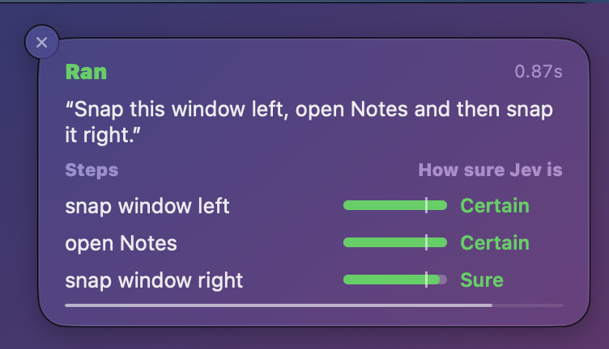
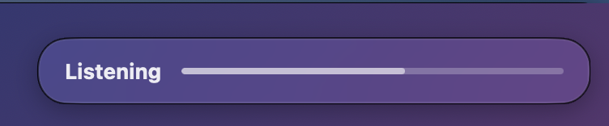
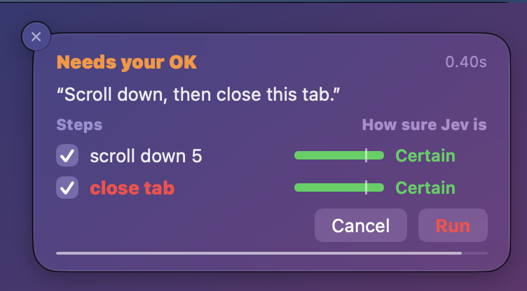
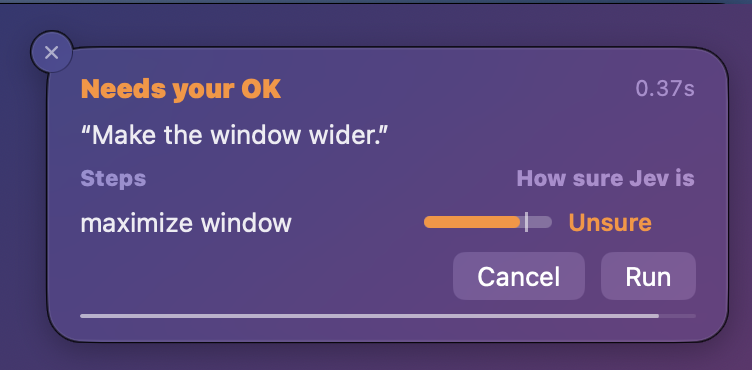
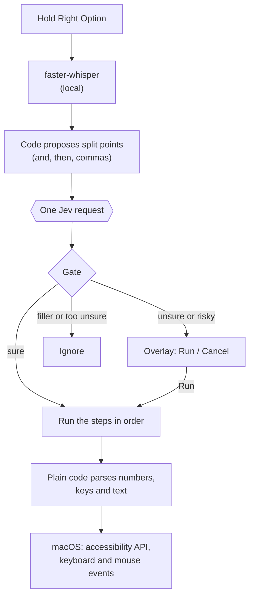
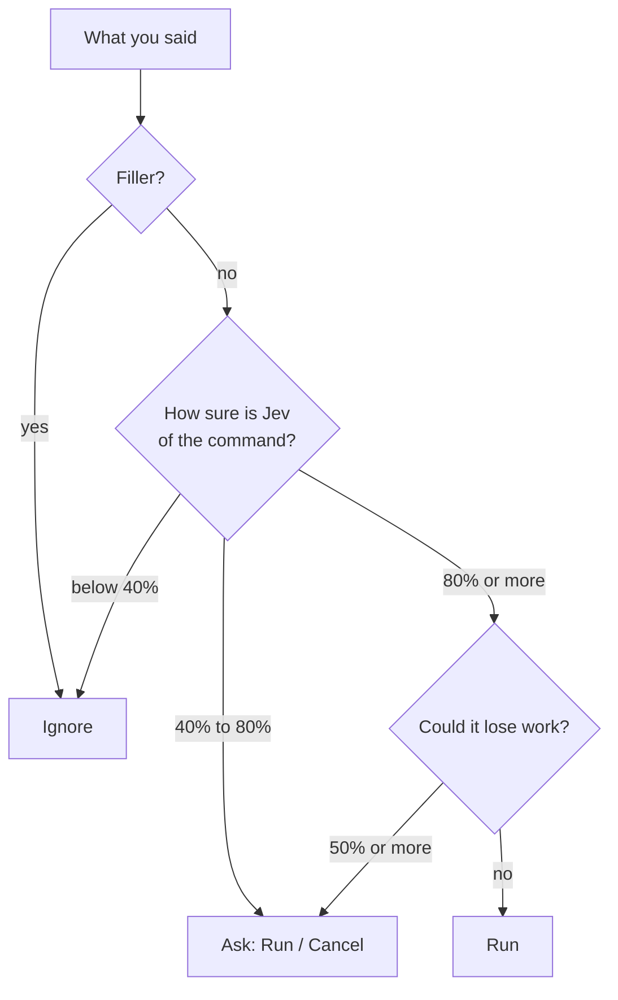

# voicecom-jev

[](https://github.com/MatthewRuizDiaz/voicecom-jev/actions/workflows/ci.yml) [](LICENSE)

**Hold a key, say what you want, and your Mac does it, several commands at a time.** "Snap this window left, open Notes and snap it right" takes about a second, from letting go of the key to done.

Speech stays on your Mac ([faster-whisper](https://github.com/SYSTRAN/faster-whisper)). Every decision (which command, where one command ends and the next begins, whether it could lose work, which button you meant) is a typed question to TypeSafe's **Jev** model, which answers with probabilities instead of generated text. The actions themselves are plain, deterministic code.

> **Unofficial project.** voicecom-jev is a personal project. It is not affiliated with, endorsed by, or supported by TypeSafe AI.

<p align="center"></p>

## What it does

- **Several commands in one sentence.** "Open Safari and search for tacos" runs two steps in order. "Type salt and pepper" stays one.
- **Shows its work.** A glass panel in the corner shows what it heard, each step, and how sure Jev is. It never takes focus, and it fades on its own.
- **Asks before anything risky or unclear.** You can untick the steps you don't want, then click Run.
- **Ignores filler.** "Um…" or a cough does nothing.
- **Clicks buttons by name.** "Click Submit" finds the button in the front window's accessibility tree.

| Listening | Risky: needs your OK | Unsure: needs your OK |
| - | - | - |
|  |  |  |


*Terminal capture of real Jev decisions in `--dry-run --text` mode ([mp4](demo/demo.mp4); regenerate with `vhs demo/demo.tape`). In normal use you hold Right Option and speak.*

## Why Jev

A voice command tool has to make many small, high-stakes judgments fast: which command, is this one command or three, would it destroy something, was that even speech. Jev is built for exactly that kind of judgment.

- **Answers are always one of your options.** Jev never invents a command or returns malformed JSON. A Choice question returns one of the options you gave it, with a probability for each.
- **The probabilities are usable as-is.** Every gate in voicecom is a plain threshold on them: run at 80%, ask between 40% and 80%, ignore below.
- **Many questions in one request.** One request asks the command for the whole sentence and for every candidate part of it, whether it's destructive, whether it's filler, and which app it names. Measured: 1 question set in 0.10s, 15 in 0.16s.
- **Cheap.** $0.042 per million input tokens, so asking twenty extra questions per sentence costs nothing worth counting.

## How it works



The one Jev request carries:

| Question | Type | Asks |
| - | - | - |
| `command` | Choice | which of the 19 commands the sentence asks for (or `dictate`) |
| `command_k` | Choice | the same, for each candidate part of the sentence |
| `destructive`, `destructive_k` | Noul | would doing this close, quit, delete, send or discard something? |
| `meaningful` | Noul | is this real speech, or just "uh", "hmm" or a cough? |
| `app`, `app_k` | Choice | which installed app is named (read only when the command takes one) |

A "click" makes one more request: voicecom reads the front window's accessibility tree and asks a second Choice over its labeled buttons, links, tabs and menu items, with a `none_of_these` option.

### Splitting a sentence into steps

Code cuts the sentence at every likely boundary, and every run of neighbouring pieces becomes a candidate part. Jev classifies them all in that one request, and voicecom picks the split with the most steps (up to 5) where every part is a confident command. "Type salt and pepper" stays whole because "pepper" on its own isn't a command. [ADR 0005](docs/adr/0005-split-chains-by-span-fan-out.md) has the details.

### The gate



For a sentence with several steps, the whole thing is gated once. If any step is risky or unsure, you get one question with a checkbox per step and the risky steps in red. A question lasts 10 seconds (hovering pauses it), and saying something new drops it. Clicks also need Jev to be at least 70% sure of the element to run without asking. Tune the thresholds with `--act` and `--ignore`, or in `voicecom/engine.py:Thresholds`.

Every command also prints one log line. These are from real runs:

```
"Open Safari." -> open_app p=1.00 conf=1.00 destr=0.03 app=Safari(1.00) | stt=0.21s jev=0.15s total=0.37s | WOULD RUN: open Safari
"Close this tab." -> close_tab p=1.00 conf=1.00 destr=0.95 | stt=0.30s jev=0.13s total=0.43s | CONFIRM (destructive): close tab
"Snap this window left, open Notes and then snap it right." -> chain snap_left(1.00) → open_app(1.00) → snap_right(0.93) destr=0.03 | jev=0.14s | WOULD RUN: snap window left, then open Notes, then snap window right
"Umm..." -> dictate p=1.00 conf=1.00 destr=0.05 meaningful=0.03 | stt=0.23s jev=0.10s total=0.32s | IGNORED (filler)
```

## Commands

| Command | Say something like |
| - | - |
| `open_app` | "open Chrome", "switch to Slack", "open my email" (asks "open Mail?") |
| `quit_app` | "quit Spotify" |
| `click` | "click Submit", "press the Sign in button" |
| `scroll_down` / `scroll_up` | "scroll down", "scroll up a little", "scroll down 10" |
| `press_keys` | "press enter", "press command shift T" |
| `type_text` | "type see you tomorrow" |
| `snap_left` / `snap_right` | "snap this window left" |
| `maximize_window` | "maximize this window" |
| `volume_up` / `volume_down` | "turn it up", "volume down 20" |
| `set_volume` | "set volume to thirty percent" |
| `mute` | "mute" |
| `new_tab` / `close_tab` | "new tab", "close this tab" |
| `new_note` | "new note call the dentist", "open Notes and type meeting at 3" |
| `web_search` | "search for the best tacos in Austin" (uses your default search engine) |
| `dictate` | anything that isn't a command gets typed as-is |

Combine any of them with "and", "then" or a pause. `voicecom --list` prints them with the descriptions Jev sees.

### Adding a command

Add a function to `voicecom/commands.py`. The description is what Jev chooses by; the body is plain code that returns a `Plan`:

```python
@command("lock_screen", "Lock the computer's screen.")
def lock_screen(ctx):
    return Plan("lock screen", lambda: ctx.auto.press(["ctrl", "cmd", "q"]))
```

## Install (macOS)

Requires macOS on Apple Silicon or Intel, Python 3.10+, and a [TypeSafe API key](https://console.typesafe.ai/keys).

```bash
brew install python@3.12 portaudio
git clone https://github.com/MatthewRuizDiaz/voicecom-jev.git && cd voicecom-jev
python3.12 -m venv .venv && .venv/bin/pip install -r requirements.txt
cp .env.example .env   # then put your key in .env
```

Or install the `voicecom` command with pipx (`brew install pipx` first): `pipx install git+https://github.com/MatthewRuizDiaz/voicecom-jev.git`. It reads `TYPESAFE_API_KEY` from the environment or from a `.env` in the folder you run it from.

macOS grants permissions to the app you run voicecom from (Terminal, iTerm, Claude…), not to Python. Run the check once from that app:

```bash
.venv/bin/python -m voicecom --check
```

It reports **Microphone** (to record while the key is held), **Input Monitoring** (for the push-to-talk key in any app) and **Accessibility** (to click, type, scroll and move windows). It shows the system prompt for any that are missing, names the app to turn on, and opens the right page in System Settings. After turning them on, quit and reopen that app and run the check again. `--check --no-prompt` only reports.

The first run downloads the Whisper model (`base.en`, about 140 MB).

## Usage

```bash
.venv/bin/python -m voicecom                 # hold Right Option, speak, release
.venv/bin/python -m voicecom --dry-run       # decide and show, but don't touch anything
.venv/bin/python -m voicecom --text "open chrome" --text "scroll down"   # no mic
.venv/bin/python -m voicecom --repl          # type commands at a prompt
```

Other options: `--hotkey {alt_r,cmd_r,ctrl_r,f13,f18,alt}`, `--whisper-model small.en` for better accuracy, `--no-overlay` for the terminal log only, and `--speak` to also ask confirmations out loud.

## Project layout

```
voicecom/
  __main__.py          CLI, push-to-talk loop
  stt.py               mic recording + faster-whisper
  jev.py               every TypeSafe call: decide(), pick_element()
  chain.py             several commands in one sentence: candidate parts and the best split
  engine.py            the gate, confirmations, one log line per command
  registry.py          Command / Plan / @command
  commands.py          the 19 commands
  parse.py             numbers, key chords, free text
  view.py, overlay.py  the Card the engine shows, and the glass panel that draws it
  platforms/
    base.py            Automation interface + DryRun wrapper
    macos.py           accessibility API, Quartz events, osascript
    macos_permissions.py   the --check permission report
tests/                 gate, parser and splitting tests with Jev stubbed; CI runs them and ruff on every push
```

The OS layer sits behind `platforms/base.py:Automation`. Only macOS is implemented; a Windows or Linux port means writing one class.

Design decisions are recorded as ADRs in [`docs/adr/`](docs/adr), and the project's vocabulary is in [`GLOSSARY.md`](GLOSSARY.md).

## Limitations

This is a prototype. It isn't hardened or benchmarked. Click-by-label depends on how well each app exposes accessibility labels: native apps and Chromium browsers work well, and some Electron and game UIs expose little. Key chords assume a US keyboard layout. Dictation that happens to sound like several commands ("type I'll open Safari and search for it") will be split.
